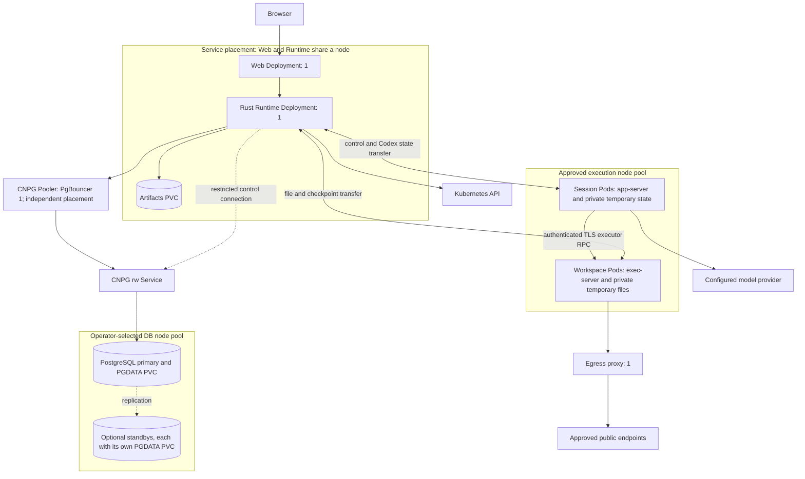

# Architecture

## Scope and design status

allein provides a shared website through which multiple users operate their own Codex conversations and server-side workspaces.
The browser submits prompts and files, displays progress and conversation history, and browses workspace files.
Rust services own authorization, orchestration, event delivery, workspace I/O, and persistence.
React and Vite produce the browser application, which Nginx serves.
Kubernetes is the deployment platform, including k3s installations that satisfy the isolation and storage contract.

This document is the canonical v1 design contract.
Application code, charts, images, and working CI are not implemented, and cluster execution, recovery, isolation, and capacity have not been verified.
Official sources establish upstream behavior; allein-specific statements define implementation requirements.
Authentication providers, visual design, detailed API schemas, and the complete conversation lifecycle are outside this document's scope.
Custom tools and MCP integrations are outside v1.

## Deployment topology and ownership

### Operating model

v1 has one Web instance, one Rust Runtime instance, one Egress proxy instance, and one PgBouncer instance.
Application-service horizontal scaling and service-wide high availability are unsupported.
The Runtime is the single coordinator and rejects a second active coordinator for the same installation.
Different conversations execute concurrently through temporary Session and Workspace Pods, subject to installation and per-user limits.

The service node is the node selected for the Web and Runtime workloads, which must run together.
It is an application placement role, not a requirement to use the Kubernetes control-plane node.
PostgreSQL placement is independent: operators may put all static workloads on one node, separate the DB onto another node, or distribute PostgreSQL instances across a DB node pool.
Adding DB replicas does not remove the application's singleton service dependencies.

Namespaces define policy scopes, not physical node placement.
Administrators prepare the service, database, and workspace namespaces selected by the installation; the database namespace may be the service namespace.
The CNPG `Cluster` and its `Pooler` must share a namespace, while their Pods may run on different nodes.
Session Pods use the service namespace and Workspace Pods use the designated workspace namespace; both are scheduled into the approved execution node pool.

| Workload | v1 count and controller | Placement and responsibility | Persistent volume |
| --- | --- | --- | --- |
| Web | Deployment, `replicas: 1` | Same node as Runtime; Nginx serves the browser bundle and routes API/event traffic | None |
| Rust Runtime | Deployment, `replicas: 1` | Operator-selected service node; API, authorization, orchestration, checkpoint publication, and artifact file service | One separately retained Artifacts PVC |
| Egress proxy | Deployment, `replicas: 1` | Service node by default, independently configurable; permitted external workspace traffic | None |
| PgBouncer | CNPG `Pooler`, `spec.instances: 1` | Service node by default, independently configurable; pooled application SQL | None |
| PostgreSQL | CNPG `Cluster`, `spec.instances: 1` by default | Independently selected DB node pool; operators may add standby instances | One PGDATA PVC per instance by default |
| Session Pod | Runtime-created Pod, one per active session | Execution node pool; Rust adapter supervises one upstream app-server process over stdio | None; private `emptyDir` |
| Workspace Pod | Runtime-created Pod, one per active session | Execution node pool; executor container runs commands and an I/O helper supports file transfer and checkpoints | None; private `emptyDir` |

The Web, Rust Runtime, and Egress proxy Deployments each set `spec.strategy.type: Recreate` as the v1 chart default; planned replacement can interrupt service.
CNPG owns PostgreSQL and PgBouncer Pod replacement under their configured lifecycle policies.
Deployment replica counts and `Recreate` do not replace the Runtime coordination guard.

The default steady state is five static application/DB Pods plus two temporary Pods per active session, excluding the shared CNPG operator, ingress infrastructure, and maintenance jobs.
The default persistent storage is two PVCs: Artifacts and the single PostgreSQL instance's PGDATA.
Additional PostgreSQL instances or an operator-selected separate WAL volume add their own storage.

Only the web/API edge is user-facing.
App-server, executor, I/O helper, PgBouncer, database, and orchestration endpoints remain private.
Session adapters and workspace helpers are narrow Rust roles, not additional management systems.
The executor's loopback WebSocket endpoint is wrapped by the workspace helper's authenticated TLS endpoint; app-server uses private stdio through its adapter.
The adapter and helper protocols, health checks, and shutdown handshake must be implemented and verified.

### Maintainer and operator boundaries

| Owner | Responsibility |
| --- | --- |
| allein maintainers | Source, tests, images, Helm definitions, fixed singleton application semantics, Web/Runtime co-location, approved temporary Pod templates, browser protocol, checkpoint format, and isolation requirements |
| Installation operator | Node selection, storage classes and capacity, resource budgets, execution concurrency, DB instance count, replication durability, backup targets, and the cluster's enforcement/runtime prerequisites |
| CNPG operator | Reconciliation of declared PostgreSQL instances, their services and storage, and the declared PgBouncer Pooler |
| allein Runtime | Admission, ownership checks, temporary Pod creation/deletion, observation of execution state, artifact I/O, and checkpoint publication |
| Consuming GitOps configuration | Pinned public releases, installation overrides, static resource registration, and reviewed desired state |

The installation supplies a ready CNPG operator and CRDs as cluster prerequisites.
allein owns its product-specific `Cluster` and `Pooler` declarations; it does not install another shared operator or directly manage the PostgreSQL Pods as a StatefulSet.
An operator being installed is not evidence that the product database, credentials, storage, or backups exist.
CNPG [pooling](https://github.com/cloudnative-pg/cloudnative-pg/blob/release-1.30/docs/src/connection_pooling.md) and [scheduling](https://github.com/cloudnative-pg/cloudnative-pg/blob/release-1.30/docs/src/scheduling.md) provide separate DB and Pooler placement controls.

Chart defaults encode the product contract; installation values supply permitted placement, storage, and capacity choices.
Web follows Runtime with required Pod affinity on the node hostname, scoped to the installation, rather than reciprocal affinity that prevents initial scheduling.
Service-node migration replaces both workloads in a coordinated operation; scheduling affinity alone does not relocate an already-running Web Pod.
The chart exposes independent DB, Pooler, Egress proxy, and execution placement controls.
It does not expose horizontal autoscaling for singleton application services.
Conflicting overrides must fail validation or leave an explicit unschedulable condition, rather than silently weakening co-location or isolation.

The operator selects the service node through Runtime placement and the Artifacts volume's topology.
A node-local Artifacts volume anchors Runtime and therefore Web; changing affinity alone does not move existing data.
A [k3s local-path volume](https://docs.k3s.io/add-ons/storage) is suitable when that node dependency is accepted.
Other storage classes may provide different attachment and recovery behavior, without changing the singleton application contract.

The Runtime creates ordinary temporary Pods and narrowly scoped supporting endpoints from approved templates.
A Deployment must not recreate an intentionally suspended workspace, and Job retry policies must not replay interactive model turns or shell side effects.
Argo CD owns static installation declarations and must not also reconcile Runtime-created temporary resources.
Database and artifact retention have explicit lifecycles separate from application replacement and temporary Pod cleanup; application upgrades or teardown must not silently authorize data deletion.
Chart packaging and retention checks must enforce that separation.

## Databases and storage

### Storage inventory

| Data | Durable owner and location | Active use |
| --- | --- | --- |
| Users, external identity links, website login sessions, permissions, and product business records | Product PostgreSQL database | Runtime |
| Conversation catalog, accepted prompts, durable messages, completed results, and UI state projections | Product PostgreSQL database | Runtime and authorized browser operations |
| Workspace/session mappings, accepted-operation journal, idempotency records, assignment generations, and checkpoint publication records | Product PostgreSQL database | Runtime reconciliation and admission |
| File ownership, artifact identities, size/checksum metadata, and checkpoint references | Product PostgreSQL database | Runtime file service and authorization |
| Uploaded originals and retained exported files | Artifacts file store on Runtime's PVC | Authorized transfers into or out of an assigned workspace |
| Workspace checkpoints, including project/Git data and declared persistent home/tool files | Artifacts file store | Private Workspace `emptyDir` while running |
| Upstream Codex continuation bundles, including required rollout and SQLite state | Artifacts file store, separately protected from user workspace archives | Private Session `emptyDir` while running |
| Intermediate output and diagnostic streams | Bounded buffers; retained bulk output uses artifact files, while necessary durable results use PostgreSQL | Adapter, helper, Runtime, and browser subscriptions |
| Provider credential records | Encrypted credential storage in PostgreSQL, separate from ordinary artifacts | Authorized materialization in the owning Session only |
| Encryption keys and service credentials | Installation-managed Kubernetes Secrets or the selected secret-management integration | Only the services that require them |
| PostgreSQL and artifact backups | Operator-managed backup target independent of the source node/storage failure domain | Restore procedures |
| Immutable application and environment images | Published registry artifacts | Node-managed image cache |

The database is one product logical database in one CNPG Cluster.
Users, conversations, business records, and execution metadata are separated by table/schema ownership and access rules, not by a PostgreSQL database or server per user or session.
Redis and a separate message broker are not required v1 services.
A durable operation journal plus bounded Runtime memory serves the single-coordinator scheduling contract.

Large file content, checkpoint archives, and unbounded raw token streams do not belong in PostgreSQL.
Runtime's Artifacts PVC is the default durable file store and requires no additional object-storage or NFS server.
Only Runtime mounts that persistent store; worker Pods transfer authorized content over the service protocol.
Artifacts and the database outlive Session and Workspace Pods.
A database reference, a UI transcript, and a Codex continuation bundle are different data responsibilities and cannot substitute for one another.

The pinned upstream Codex SQLite databases are internal session state, not additional PostgreSQL services.
Each session gets its own managed Codex state roots.
Their storage and recovery requirements are described under [checkpoints](#checkpoints-and-suspension).

### PostgreSQL access and contention

General application SQL follows Runtime's bounded connection pool through the single PgBouncer Pooler to the CNPG `rw` service.
The Pooler uses `type: rw` and `pgbouncer.poolMode: transaction`.
There is one product SQL role for normal application access rather than one PostgreSQL connection pool/role per website user.
Tenant authorization remains a Runtime responsibility on every operation.

A dedicated direct PostgreSQL session holds the Runtime's installation-scoped coordination lock.
A second coordinator must refuse admission, and loss of the control connection stops new mutations until ownership is re-established and execution state is reconciled.
This control connection and narrowly authorized migrations bypass PgBouncer; ordinary traffic does not open unbounded direct connections during Pooler failure.
Transaction pooling cannot preserve session-level advisory locks, as documented in [PgBouncer's feature matrix](https://www.pgbouncer.org/features.html).
Driver prepared statements and other session-dependent features require explicit compatibility checks.

Bound the application pool, Pooler backend connections, direct control/maintenance connections, and PostgreSQL reserved capacity together.
PgBouncer [pool sizes are per user/database pair](https://www.pgbouncer.org/config.html#default_pool_size), so count all pools and account for configured rollout overlap.
The sizing reference is approximately 100 connected users, not 100 continuously occupied database connections or a promise of 100 simultaneous Codex executions.
Release capacity tests determine actual connection and execution budgets; no throughput or latency result is established by this design.

Keep transactions short and use consistent lock ordering.
Do not hold a connection or transaction while waiting for a model, user approval, file transfer, or Kubernetes operation.
Persist necessary event state in bounded batches rather than one transaction per output token.
Index ownership/session lookups and avoid a single long-locked global state row.
Deadlock retries apply only to bounded, safe SQL transactions, not to already-issued external commands or model turns.
PostgreSQL's [locking guidance](https://www.postgresql.org/docs/18/explicit-locking.html#LOCKING-DEADLOCKS) describes consistent ordering and deadlock retry behavior.

Database/schema separation inside the same PostgreSQL server does not create independent CPU, memory, or disk capacity.
Separate servers are justified by measured independent workload or isolation requirements, not the connected-user count alone.
CNPG [physical standbys](https://github.com/cloudnative-pg/cloudnative-pg/blob/release-1.30/docs/src/replication.md) replicate the same data; adding instances improves DB resilience rather than sharding application writes.
v1 does not route ordinary application reads to standbys.

### Volumes and backups

PostgreSQL uses one PGDATA PVC per instance by default.
An operator may configure a separate WAL volume through CNPG when its capacity or storage characteristics justify it.
Splitting PVCs on the same physical disk does not by itself isolate I/O load.
CNPG's [storage reference](https://github.com/cloudnative-pg/cloudnative-pg/blob/release-1.30/docs/src/storage.md) defines per-instance storage and optional WAL volumes.

Active Session and Workspace storage uses private Kubernetes `emptyDir` volumes with size/resource budgets.
These volumes are scratch state, not durable copies and not retained per-conversation PVCs.
A replacement worker restores from Artifacts and does not need to attach the previous worker's local disk.
Checkpoint transfer, compression, retention, and concurrent upload limits must keep bulk I/O from starving the singleton Runtime or database.

Operators provide separate PostgreSQL and Artifacts backup procedures and an off-node backup target.
DB replicas do not replace backups, and DB backups do not contain the artifact files.
PostgreSQL recovery follows the selected [CNPG backup mechanism](https://github.com/cloudnative-pg/cloudnative-pg/blob/release-1.30/docs/src/backup.md); artifact recovery follows its own verified file-store procedure.
Restore boundaries must keep DB checkpoint references consistent with the available artifact versions and required decryption keys.
Credential keys and required service secrets need a protected recovery procedure as well.
Replication and backup durability do not imply service-wide HA.

## Codex baseline and verified boundaries

Use upstream Codex `0.170.0`, release tag `rust-v0.170.0`, resolved to commit `29eb79e9866b3262a777fdf8195c1b9e63684c91`.
Both app-server and exec-server must use that version, and allein images must pin their own artifact digests and verify embedded upstream artifacts.
The [official release](https://github.com/openai/codex/releases/tag/rust-v0.170.0) contains standalone executor packages as well as Codex packages.
Current online documentation can describe another release; version-specific source takes precedence for integration details.

| Upstream component | Verified role | allein responsibility outside that role |
| --- | --- | --- |
| `codex app-server` | Codex conversation harness with thread and turn APIs, model interaction, events, and client approval requests | Web accounts, tenant authorization, Kubernetes provisioning, checkpoint coordination, and browser APIs |
| `codex exec-server` / `codex-exec-server` | Process execution and filesystem RPC service for an execution environment | Creating containers, assigning workspaces, durable storage, and cluster isolation |
| Codex sandbox and network configuration | Additional restrictions on operations performed through configured Codex paths | Enforcing the boundary for every process and network path in an untrusted workspace |

App-server is part of the upstream Rust implementation, rather than an allein fork or a Kubernetes controller.
It can run as a process in a container; allein supplies container packaging, lifecycle management, and a web-facing application.
The [app-server guide](https://developers.openai.com/codex/app-server/) documents bidirectional JSON-RPC, the default stdio transport, and thread/turn interaction.
Its WebSocket transport is documented as experimental and unsupported, with authentication requiring explicit configuration.
The selected app-server transport is private stdio through an allein session adapter; browsers do not connect to app-server directly.

Remote execution exists in the pinned release.
The source defines experimental [`environment/add`](https://github.com/openai/codex/blob/29eb79e9866b3262a777fdf8195c1b9e63684c91/codex-rs/app-server-protocol/src/protocol/common.rs), including an executor URL and optional bearer credential in [`EnvironmentAddParams`](https://github.com/openai/codex/blob/29eb79e9866b3262a777fdf8195c1b9e63684c91/codex-rs/app-server-protocol/src/protocol/v2/environment.rs).
Explicit environment selection on [`thread/start`](https://github.com/openai/codex/blob/29eb79e9866b3262a777fdf8195c1b9e63684c91/codex-rs/app-server-protocol/src/protocol/v2/thread.rs) and [`turn/start`](https://github.com/openai/codex/blob/29eb79e9866b3262a777fdf8195c1b9e63684c91/codex-rs/app-server-protocol/src/protocol/v2/turn.rs) is also experimental.
These calls require experimental API opt-in and release-specific compatibility checks.
Generate any integration schemas from the pinned executable with the required experimental surface; the checked-in stable TypeScript schemas omit relevant experimental fields.

The [executor README](https://github.com/openai/codex/blob/29eb79e9866b3262a777fdf8195c1b9e63684c91/codex-rs/exec-server/README.md) describes direct WebSocket process/filesystem RPCs, listener authentication, and remote registry/relay modes.
v1 uses a direct private executor connection protected by TLS and a per-session credential.
It does not require OpenAI's remote environment registry, Noise rendezvous infrastructure, or a replica of those services.
An executor is an application process inside a Kubernetes container; its name does not denote a separate container runtime.

Multiple thread IDs are not a tenant security boundary.
The pinned [account-history behavior](https://github.com/openai/codex/blob/29eb79e9866b3262a777fdf8195c1b9e63684c91/codex-rs/app-server/README.md#local-history-by-account) explicitly leaves direct thread-ID access available, and API-key sessions can discover all local history.
allein authorizes every operation against its own ownership records and does not share an app-server process or writable Codex state directory across users.

App-server's `fs/*` methods do not provide a remote workspace file browser.
In this release, [`FsRequestProcessor::file_system()`](https://github.com/openai/codex/blob/29eb79e9866b3262a777fdf8195c1b9e63684c91/codex-rs/app-server/src/request_processors/fs_processor.rs) selects the local environment and errors when no local filesystem is configured.
Remote workspace uploads, downloads, and directory browsing therefore use allein's workspace I/O path.
Prompt protocol support does not provide HTTP multipart upload handling or a complete browser file-management service.

## Conversations and Runtime ownership

| Concept | Owner and boundary |
| --- | --- |
| User / tenant | allein authorization domain, independent of Kubernetes service accounts and Codex provider authentication |
| Conversation | Durable user-owned chat mapped to upstream Codex thread identity |
| Workspace | Durable user-owned filesystem identity with checkpoint history |
| Active session | Temporary assignment of one conversation/workspace to a Session Pod and a Workspace Pod |
| Checkpoint | Published workspace/Codex-state pair with version, integrity, and recovery-boundary metadata |

Each independent v1 conversation owns one workspace and at most one active session.
One session receives one app-server process and one executor environment.
Codex-created child threads stay within that session's workspace and security boundary; they do not automatically receive another Pod.
Different conversations may execute concurrently within configured limits.

The pairing keeps credentials, persistence, and idle suspension independent for each conversation.
Browser connections are subscribers, not execution owners.
Closing a browser must not implicitly abandon active work.
A workspace has one authorized writer generation; requests from another tab reuse or wait for that assignment.

Runtime owns desired state, admission, operation records, assignment generations, and reconciliation.
PostgreSQL records durable ownership and assignments, and Kubernetes reports observed Pod state.
The only copy of a workspace manifest must not live in process memory.
Fixed templates plus bounded database records and watches are sufficient; a CRD or permanent controller workload per conversation is not required.
A process-level coordination lock alone does not prove that an old workspace writer has terminated.

## Request and event flow

1. Runtime authenticates the browser session and checks ownership for history, prompts, files, subscriptions, approvals, and every subsequent action.
2. It records an accepted operation with an idempotency identity and admits it within quotas and the current workspace generation.
3. For a suspended workspace, it provisions temporary Pods/storage, restores the committed checkpoint through the artifact service, and regenerates temporary addresses and credentials.
4. The session adapter starts `codex app-server`, sends `initialize` with the required experimental capability, and acknowledges with `initialized`.
5. It registers or loads only the assigned executor, starts or resumes the mapped thread, and selects that remote environment before admitting a turn.
6. The adapter submits `turn/start`; app-server calls the model provider and uses exec-server for remote execution and filesystem operations.
7. Runtime receives and normalizes thread, turn, item, output, approval, completion, and error traffic for authorized browser subscriptions.
8. The session becomes eligible for idle suspension only after active work and outstanding interactions are resolved.

The [upstream environment configuration](https://github.com/openai/codex/blob/29eb79e9866b3262a777fdf8195c1b9e63684c91/codex-rs/exec-server/src/environment_toml.rs) supports `include_local = false`.
Use a controlled configuration that omits the local executor and binds only the assigned remote environment.
Do not rely on `cwd` alone or silently execute in the Session Pod if the Workspace Pod is unavailable.
Remote-only routing must cover shell tools, file changes, and inherited child-thread behavior.
Session containers must restrict local process launch and outbound access so accidental local paths cannot become privileged execution fallbacks.

allein versions its browser protocol independently of upstream Codex.
Events carry conversation identity, generation, ordering/cursor information, and upstream correlation IDs where present.
Preserve final status, errors, approvals, and input requests rather than reducing traffic to text deltas.
Server-initiated requests need an authorized reply path through the owning session.
Persist sufficient results and cursors for reconnects, bound streaming queues, and reconcile final state after gaps.
A dropped stream does not prove failure; an ambiguous submission must not be retried as a new turn without reconciliation.

Browsers do not supply raw upstream JSON-RPC, executor URLs, arbitrary configuration overrides, or filesystem roots.
Website login establishes allein identity; provider authentication is a separate credential boundary materialized only for the owning session.
Specific provider login methods remain outside this contract.

Uploads receive durable artifact identities and are materialized in the assigned workspace through authorized I/O.
File browsing lists bounded content under allowed workspace roots, with validated paths, links, sizes, and transfer limits.
It must not expose another workspace or the Session Pod's credential/state directories.
Inputs that require harness-side materialization use an explicit authorized path there.
Saved attachment references must remain resolvable after Pod replacement; browser-local and obsolete Pod-local paths are not durable references.
Suspended conversations and saved file trees are inspectable through database projections and checkpoint indexes without starting Codex.

## Checkpoints and suspension

The persistence unit is a filesystem-and-conversation checkpoint.
It does not preserve process memory, open terminals, sockets, daemons, or arbitrary changes in the writable container image layer.
Recovery uses an immutable base image plus declared writable roots and separately protected Codex continuation state.
Declared roots include project/Git data, dirty and untracked files, and the home/tool state that the environment promises to retain.
Disposable caches and unsupported writes outside these roots have explicit lifetime rules.
Arbitrary root package installation is not a v1 recovery guarantee.

Codex continuation state is separate from the workspace tree.
The pinned implementation uses [rollout recording](https://github.com/openai/codex/blob/29eb79e9866b3262a777fdf8195c1b9e63684c91/codex-rs/rollout/src/recorder.rs) and [SQLite state](https://github.com/openai/codex/blob/29eb79e9866b3262a777fdf8195c1b9e63684c91/codex-rs/state/src/runtime.rs).
A saved UI transcript or file tree alone is not an established `thread/resume` recovery procedure.
Keep the required SQLite paths inside private managed state roots and preserve the required durable state with the workspace checkpoint.
Several harnesses must not share a writable Codex home or SQLite directory.
Keep credential records, encryption keys, regenerated endpoint settings, and transient secrets out of ordinary reusable archives.
The exact state inventory and restore procedure require verification against the pinned binary.

Idle means no running turn, pending approval/input decision, file mutation, or background work still being serviced.
Browser disconnection or lack of new prompts alone does not establish idleness.
Idle timeout, maximum active duration, resource budgets, and forced cancellation are explicit operating policy.

Runtime coordinates suspension in this order:

1. Stop admitting mutations for the assignment generation and drain or explicitly cancel outstanding operations.
2. Flush and stop the harness, and stop all workspace writers, including descendant/background processes and helper-side uploads.
3. Retain the temporary volumes and transfer helpers while consistently archiving the stopped harness's durable state and the stopped executor's declared roots.
4. Complete durable artifact writes, verify integrity, and publish both checkpoint references in a short PostgreSQL transaction that checks the assignment generation.
5. Mark the workspace suspended and delete temporary Pods and endpoints only after successful publication.

Stopping only a known shell process does not prove all writers have stopped.
The helper/executor arrangement must stop the execution domain while retaining its volumes long enough for transfer.
Deleting the Pod first loses `emptyDir`; a `preStop` hook or the native sidecar shutdown window is not the checkpoint transaction.
The [sidecar lifecycle](https://kubernetes.io/docs/concepts/workloads/pods/sidecar-containers/) also shares Pod networking, so a helper is not an independent network-security boundary.

A checkpoint descriptor identifies ownership, format/upstream versions, base image identity, both state bundles, integrity data, and an operation/event recovery boundary.
Generation checks prevent a stale publisher from replacing a newer reference.
File-store writes and PostgreSQL are not one atomic storage transaction: publish only completed content, retain the previous committed checkpoint on failure, and reclaim abandoned uploads without deleting referenced or in-flight content.
Archive extraction treats filenames, links, and metadata as untrusted and cannot escape the declared destination.
Provider credentials and current executor tokens are re-established through their protected channel.

Checkpoint failure must not be reported as suspension success or discard the only recoverable working copy.
Bound retries and retained failed-session resources, report the failure, and apply explicit operator recovery or data-loss policy if resources cannot be retained indefinitely.
The last committed checkpoint is the recovery point after unexpected worker loss.
Files changed since that checkpoint may be lost even if newer accepted input or UI events remain in PostgreSQL.
Expose that boundary to the user, and do not replay shell commands or model turns to reconstruct missing changes.
Checkpoint cadence and tolerated loss are operating policy; idle-only snapshots do not establish an active-session recovery-point guarantee.

## Failure and recovery

| Failure | Effect and recovery contract |
| --- | --- |
| Web Pod restart | Browser connections drop; Runtime and execution may continue; clients reconnect and reconcile through authorized cursors/state |
| Runtime Pod restart | API and coordination pause; recover durable records, reacquire the control lock, and reconcile observed Pods before admitting mutations |
| Service-node failure | Web/Runtime and a node-local Artifacts store are unavailable; a healthy remote DB does not keep the product available; recover the node or restore artifacts on a replacement service node |
| PgBouncer failure | General SQL access pauses; restrict mutations and reconnect after Pooler recovery; do not open an unlimited direct-connection fallback |
| PostgreSQL Pod failure with usable storage | CNPG recovers the instance; pause DB-dependent mutation/publication and rebuild control/application connections after recovery |
| DB-node failure with one instance and a local PV | No standby can promote; await node recovery or restore a backup onto new storage and perform an explicit database access transition |
| Primary-node failure with eligible standby instances | CNPG may promote under its safety/durability policy; connections and transactions can fail; reconnect, reacquire control ownership, and reconcile ambiguous results |
| Standby-node failure | Primary may remain available with reduced redundancy; writes can wait if the configured synchronous requirement is no longer satisfied |
| Session/Workspace Pod or execution-worker failure | Interrupt affected sessions; restore the last committed checkpoint on eligible workers after resolving the old execution generation |
| Artifacts volume loss or exhaustion | DB references cannot reconstruct lost files; restore the artifact backup on loss, and bound/reject new uploads, checkpoints, and work admission on exhaustion |
| CNPG operator interruption | Existing DB processes may continue, while reconciliation and automated recovery are unavailable until the operator recovers |
| Single Kubernetes control-plane failure | Existing Pods may continue; new placement, execution recovery, and database failover coordination are not guaranteed |

CNPG [failover](https://github.com/cloudnative-pg/cloudnative-pg/blob/release-1.30/docs/src/failover.md) depends on eligible replicas, operator/control-plane availability, and the selected replication policy.
Operators choose asynchronous or synchronous durability and the required node separation.
Multiple DB Pods on one node do not protect against loss of that node.
Replication alone does not promise zero data loss or application availability.

Loss of the DB control connection pauses Runtime mutation/admission until ownership is verified again.
Session adapters use a bounded control-disconnection grace period, then stop active work and the associated execution domain according to cancellation policy.
Checkpoint publication may be unavailable during a service-node or DB outage, so this is not a promise to save every in-flight change.
On restart, Runtime reconciles operation records, assignment generations, Pods, and checkpoint references before admitting a replacement writer.
A database lock expiry, missing heartbeat, `NotReady` node, or force-deleted Pod object does not prove the old execution has stopped.
The old generation must be terminated or conclusively fenced; unresolved external side effects remain ambiguous and are not automatically replayed.

## Isolation and network boundaries

Namespaces organize policy and RBAC; they are not, by themselves, a hostile-code sandbox.
Use Pod security restrictions and an installation-supported sandboxed execution runtime or a separate hardened worker boundary for mutually untrusted users.
The [Kubernetes multi-tenancy guidance](https://kubernetes.io/docs/concepts/security/multi-tenancy/) describes the need for data-plane isolation beyond namespaces, and [RuntimeClass](https://kubernetes.io/docs/concepts/containers/runtime-class/) selects an installed container runtime handler rather than installing one.
The exact worker runtime and node arrangement must be validated on the target cluster.

The runtime alone receives narrowly scoped Kubernetes permissions for the designated namespaces and required resources.
Session and Workspace Pods do not receive Kubernetes API credentials or a mounted service-account token.
Workspace templates disallow privileged mode, host networking/PID/IPC namespaces, host paths, container-runtime sockets, and unnecessary capabilities.
Use non-root identities, restricted writable mounts, appropriate seccomp, and CPU, memory, process, temporary-storage, and object-size budgets.
Users cannot supply arbitrary Pod templates, service accounts, mounts, or security labels.
Admission controls and namespace policy must keep runtime-created Pods within the approved envelope.
No workspace receives database credentials, broad artifact-store credentials, another session's model credentials, or cluster administration capability.

Session Pods also require restrictive policies despite sharing the service namespace with the web and runtime workloads.
Allow only their authenticated runtime control path, assigned executor, necessary resolution, and approved provider endpoints; do not grant access to the database, Kubernetes API, other sessions, or arbitrary internal services.
The I/O helper's control credentials remain separate from executor mounts and user-process environments.
Neither a sidecar nor a namespace label replaces authentication or authorization at its endpoint.

The network contract for Workspace Pods is:

- Deny unsolicited ingress and direct egress by default.
- Permit only the owning session's executor connection and authorized runtime file/checkpoint connections on their designated ports, with authenticated session/generation binding.
- Permit only the necessary resolver and controlled egress-proxy paths for outbound requests.
- Deny lateral workspace traffic and direct access to service, Pod, node, private, link-local, metadata, and Kubernetes API addresses, including IPv6 equivalents and externally reachable cluster management endpoints.
- Permit approved public package and source endpoints through the proxy, with redirect and DNS/IP validation on every connection.

Responses to an authorized inbound connection are necessary; the requirement is no unauthorized lateral or infrastructure access, rather than literally no traffic between any two Pods.
Public package installation can involve several public hosts, not just the registry's main website.
An HTTP proxy with an enforced destination policy is the selected starting point; unrestricted protocols and direct network escape are not implied.
No new CNI choice is required solely to express that starting topology, but the installed enforcement stack must meet the complete contract.

Standard [NetworkPolicy](https://kubernetes.io/docs/concepts/services-networking/network-policies/) operates at IP/port level, is additive across policies, and is not a domain allowlist.
Its documented node-traffic exceptions and NAT-dependent behavior mean that a namespace default-deny policy alone does not establish the required API/node isolation.
Account for public node/API addresses, node-local endpoints, DNS behavior, and same-node traffic with the selected worker runtime, node firewall, or stronger enforcement boundary.
Do not claim that allowing the public internet while excluding RFC1918 ranges proves the contract.

[k3s includes an embedded network-policy controller](https://docs.k3s.io/networking/networking-services/#network-policy-controller), but the actual installation may disable it or use another CNI.
Verify enforcement on the target cluster, including sibling Pod IPs, ClusterIPs, API aliases/IPs, node addresses, metadata endpoints, redirects, and IPv6.
Policies must exist before admitting untrusted work, and additional permissive policies must not reopen the namespace.
The egress proxy must also be unable to forward requests into those protected networks.

Codex sandbox/network settings remain defense in depth.
They do not provision Kubernetes NetworkPolicies, secure node services, or establish an installation-wide tenant boundary for arbitrary processes.
Local process/config hooks, future MCP integrations, and inherited environment settings must remain within the owning session's restricted boundary.

## Delivery and verification

### Static delivery and data lifecycle

The [README](../README.md#delivery-ownership) owns the GitHub/GHCR release and consumer validation boundary.
The project supplies Helm defaults and definitions; operators maintain override values and pinned releases in the consuming deployment repository.
Project CI and deployment validation independently require `lint`, `build`, and `test` in order.
The chart source and its installation values must express the same singleton, placement, storage, and isolation contract.

Cluster-wide CNPG, execution-runtime/CNI prerequisites, namespaces, and security policy require administrative ownership.
The consuming AppProject and validators must cover the chart's namespaces, actual resource kinds, and external CNPG `Cluster`/`Pooler` schemas before adoption.
An existing CNPG operator Application is not evidence that those product resources are already permitted or validated.
Operator/PostgreSQL/PgBouncer compatibility and image versions must be pinned and checked for a release.

Static GitOps reconciliation does not own live session state.
Product database declarations, backup configuration, encryption material, and retained artifact storage must have an explicit upgrade/deletion/restore procedure that preserves their data until deletion is authorized.
The chart must not conceal a destructive data lifecycle behind an ordinary application replacement.

### Verification requirements

These are v1 acceptance requirements, not checks that have passed:

| Area | Required evidence |
| --- | --- |
| Release contract | Pinned Codex `0.170.0` components and matching experimental schemas; a compatible pinned CNPG/PostgreSQL/PgBouncer set |
| Topology | Fixed Web/Runtime/Egress proxy replica counts and `Recreate` strategy; Web/Runtime co-location; independent DB/Pooler/execution placement; default single-instance and multi-node DB profiles |
| Single coordinator and SQL | Duplicate Runtime rejection, safe control-connection loss/reacquisition, bounded transaction pooling, and driver compatibility |
| Remote execution | Authenticated direct app-server/exec-server integration without a registry/relay service; tools and child threads cannot fall back to the Session Pod |
| Tenant boundaries | Guessed thread IDs, paths, subscriptions, resumes, approvals, and credentials cannot cross users or execution workspaces |
| Browser behavior | Prompts, uploads, history, directory listing, output, approval/input replies, cancellation, and reconnect reconciliation |
| Suspension | Full writer shutdown, durable paired checkpoint publication, removal of temporary Pods, and no automatic recreation |
| Worker recovery | A fresh session on another eligible node restores dirty/untracked files and Codex continuation without the old worker disk |
| Service/DB recovery | Runtime and service-node restart, Pooler outage, single-instance DB loss, replica promotion, standby loss, and control-plane interruption follow the documented boundaries |
| Storage integrity | Partial upload/DB commit failures, stale publishers, archive extraction, quota exhaustion, cleanup, deletion retention, and coordinated DB/artifact/key restore |
| Network isolation | Unauthorized lateral, DB, API, node, metadata, proxy bypass, redirect/DNS, and IPv6 paths fail while approved package downloads succeed |
| Capacity | Approximately 100 connected users tested independently of active execution count; bounded SQL waits, events, temporary disk, artifact I/O, checkpoint latency, and failed-session cleanup |

Connected-user capacity and active-execution capacity are separate measurements.
One hundred simultaneous sessions imply roughly two hundred temporary Pods under this topology and require separate resource, provider-limit, and checkpoint-throughput testing.
The first implementation milestone validates pinned remote-only execution, private state, and stop/restore behavior before the full browser workflow is built.
No runtime, security, recovery, or performance acceptance result is established by the documentation/source review alone.
